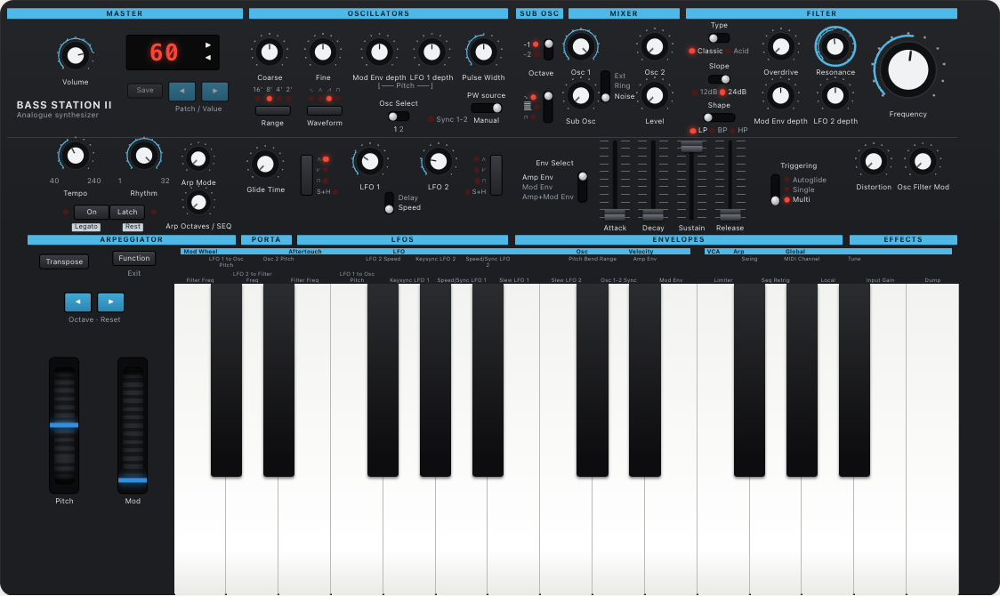
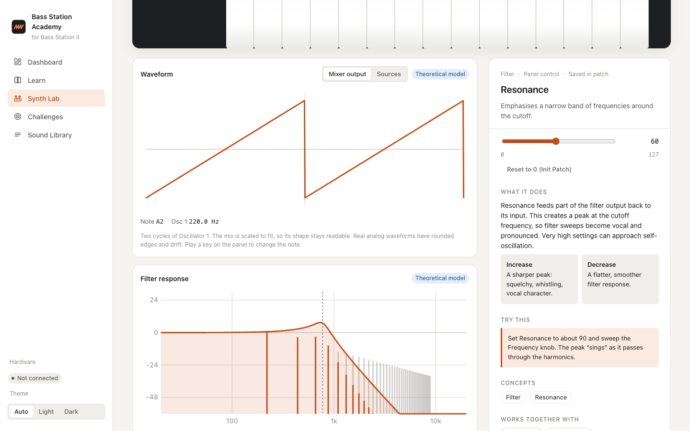
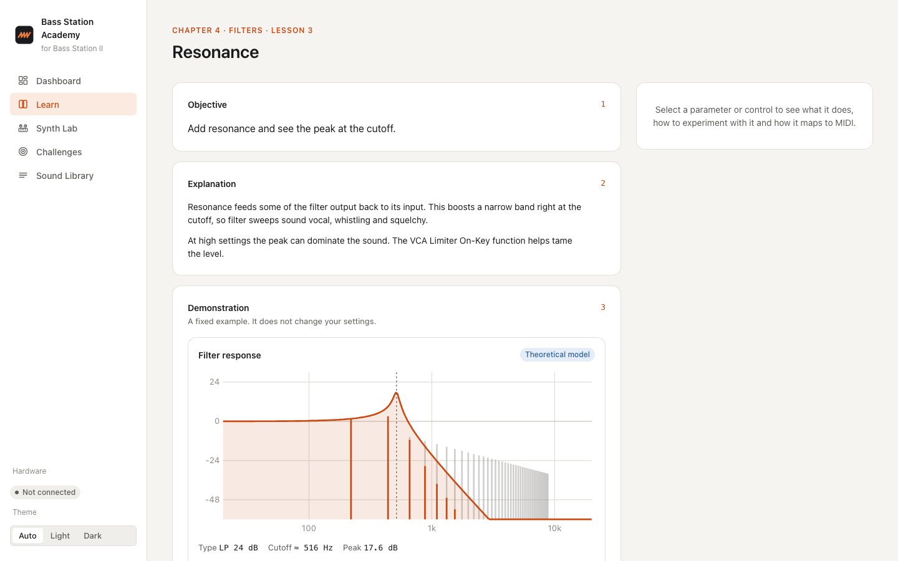
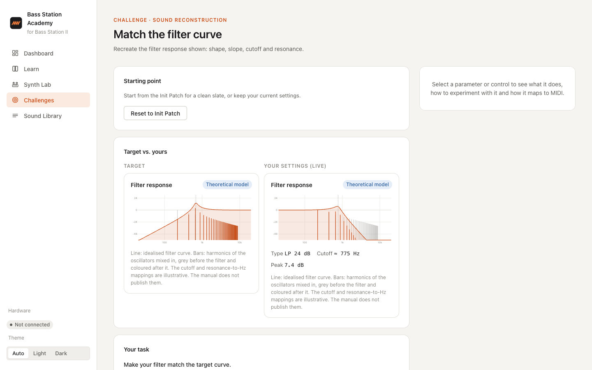
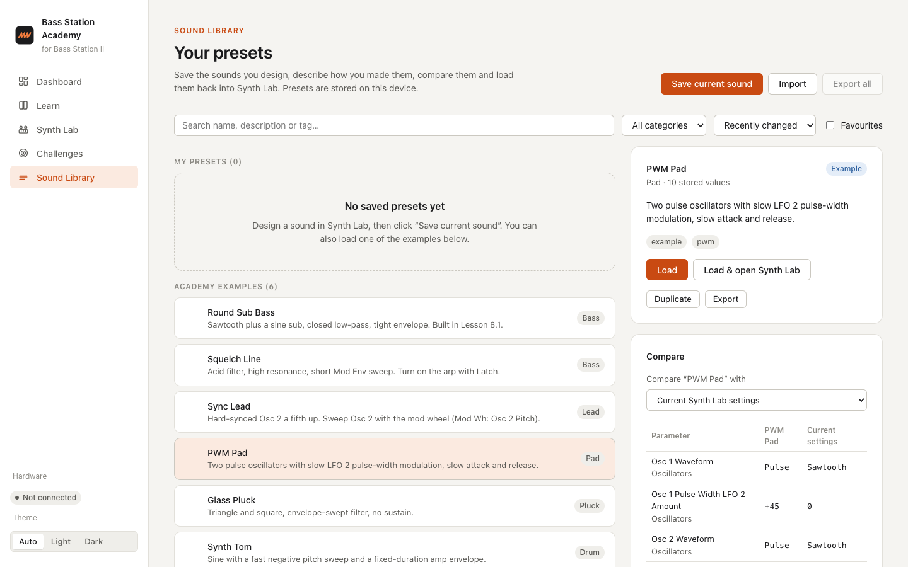
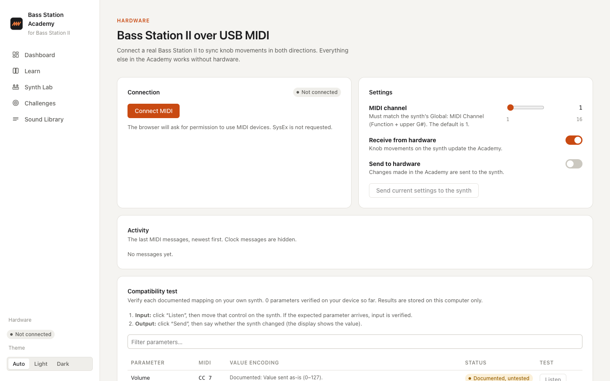
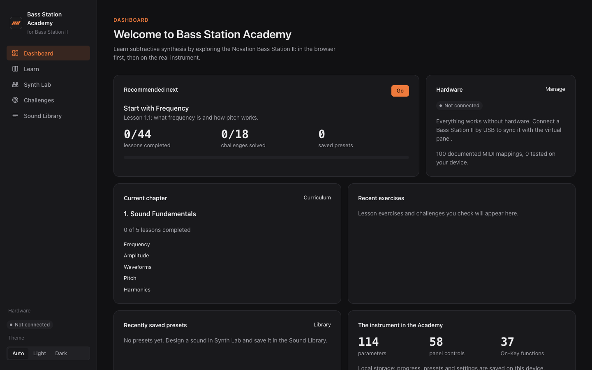

# Bass Station Academy

**An interactive web app for learning subtractive synthesis on the Novation Bass Station II.**
You turn the knobs of a virtual Bass Station II, see what each one does on live graphs, work through 44
lessons and 18 challenges, save your own sounds, and can connect a real Bass Station II over USB MIDI.



> Bass Station Academy is an independent educational project. It is not affiliated with or endorsed by
> Novation or Focusrite. “Bass Station II” is a trademark of its owner. The app makes **no sound**: it is a
> visual learning environment. The real instrument makes the sound.

---

## Contents

1. [Quick start](#quick-start)
2. [What the app can do](#what-the-app-can-do)
3. [What the app cannot do (yet)](#what-the-app-cannot-do-yet)
4. [How accurate is it?](#how-accurate-is-it)
5. [What was built, phase by phase](#what-was-built-phase-by-phase)
6. [Architecture](#architecture)
7. [Testing](#testing)
8. [Screenshots](#screenshots)
9. [Next steps](#next-steps)

---

## Quick start

```bash
npm install
npm run dev            # http://localhost:5173
```

| Command                                                 | What it does                                                                                  |
| ------------------------------------------------------- | --------------------------------------------------------------------------------------------- |
| `npm run dev`                                           | Development server                                                                            |
| `npm run build`                                         | Type-check and production build to `dist/`                                                    |
| `npm run preview`                                       | Serve the production build                                                                    |
| `npm test`                                              | 293 unit, data and component tests (Vitest)                                                   |
| `npm run test:e2e`                                      | 7 end-to-end tests in Chromium (Playwright). Run `npx playwright install chromium` once first |
| `npm run lint` / `npm run typecheck` / `npm run format` | ESLint, TypeScript, Prettier                                                                  |

Requirements: Node 20 or newer. Use desktop **Chrome** for the hardware (Web MIDI) features. Web MIDI only
works on `https://` or `localhost`. Everything else works in any modern browser, with no account and no
server.

---

## What the app can do

### Dashboard

- Overall progress: lessons completed, challenges solved, presets saved.
- **Recommended next activity**: the next lesson, or a challenge once you have done a few lessons.
- The current chapter and its lessons, your recent exercises (passed or retry), recently saved presets.
- The live hardware connection status and how many MIDI mappings you have tested on your own synth.

### Synth Lab (the core)

- **Hardware View**: a reproduction of the real Bass Station II top panel. Every control sits where it
  does on the instrument, measured from the official manual's hardware-overview figure. It includes:
  - knobs, the large Frequency knob, the ADSR faders, multi-position switches, LED select buttons
    (Range, Waveform, LFO wave), Arp On/Latch with their _Legato_/_Rest_ secondary labels, and the three-digit LED display
    with _Org. Value_ arrows;
  - pitch and mod wheels (the pitch wheel springs back to centre), Octave, Transpose and Function/Exit;
  - the **25-key keyboard with the On-Key label strip**.
- **Interaction**: drag knobs and faders up or down (Shift for fine adjustment), scroll, use the arrow
  keys, PageUp/PageDown, Home/End, and double-click to reset. Every control is keyboard-accessible and has
  slider semantics for screen readers.
- **Real panel logic**:
  - The shared oscillator controls follow _Osc Select_, and the Pulse Width knob follows the _PW source_
    switch.
  - The LFO knobs follow _Delay/Speed_ and _Speed/Sync_, the faders and Triggering switch follow
    _Env Select_ (including Amp+Mod, which edits both envelopes), and _Arp Octaves_ becomes _SEQ_ in
    Record/Play.
  - Function + Coarse/Fine edits the sub-oscillator tuning.
  - **Function + a key** opens its On-Key function. Pressing the same key again reaches the extended
    functions (Paraphonic, Oscillator Error, Filter Tracking, Envelope Retrigger and so on), and the
    ◀ ▶ buttons change the value.
  - Transpose + a key transposes, and the LFO LEDs blink at the LFO rate.
- **Learning View**: the same parameters arranged by signal flow (oscillators → mixer → filter →
  envelopes → modulation), with plain-language introductions and the matching graph.
- **Reference**: every parameter, every physical control (numbered like the manual's callouts 1–49) and
  all 25 On-Key keys, searchable, with live values.
- **Parameter inspector**: select any control to see:
  - what it does, what happens when you raise or lower it, and an experiment to try;
  - related concepts and the controls it works with;
  - where it sits on the panel and which lessons cover it;
  - its range and default, its MIDI address, and its verification status.
- **Four live visualisers**, all driven by the parameter model:
  - _Waveform_: Osc 1, Osc 2, sub, noise and ring mod, plus the mixer output, with sync and detune. It
    shows the frequency of the note you play on the virtual keyboard.
  - _Filter response_: the LP/BP/HP curve at 12/24 dB, Classic or Acid, with resonance. The bars show the
    harmonics of the mixed oscillators before and after the filter.
  - _Envelopes_: Amp and Mod ADSR curves, including fixed-duration sustain.
  - _LFOs_: both LFOs with delay fade-in, slew, and depth expressed in semitones and octaves.
  - Three extra models used in lessons: arpeggiator note order, glide trajectory and keyboard range.

### Learn

- **8 chapters and 44 complete lessons**: Sound Fundamentals, Oscillators, Mixer, Filters, Envelopes,
  Modulation, Performance and Sound Design.
- Every lesson has the six required parts:
  1. objective;
  2. explanation;
  3. demonstration (a fixed example that never touches your settings);
  4. experiment (live controls and a live graph, plus an optional "load starting point" button);
  5. exercise;
  6. validation with targeted feedback ("2 of 3 targets met: give Decay some time…").
- Exercises are either _configure the synth_ (checked against your live settings) or multiple choice, with
  an explanation for every option.
- Nothing is locked, there is no minimum score, and attempts are unlimited. Completion and the last
  opened lesson are saved.

### Challenges

18 challenges, three of each required type:

| Type                     | What you do                                                                             |
| ------------------------ | --------------------------------------------------------------------------------------- |
| Parameter identification | Click the right control on the virtual panel                                            |
| Parameter manipulation   | Reach a described goal (e.g. an acid squelch or a sync lead)                            |
| Concept comprehension    | Multiple choice with explanations                                                       |
| Sound reconstruction     | Match a target picture. The target values are hidden and you get hints after each check |
| Troubleshooting          | Load a broken patch (silence, muffled sound, a seasick lead) and fix it                 |
| Visual interpretation    | Read a waveform, filter curve or envelope                                               |

A challenge shows a takeaway once solved, links to its related lesson and records attempts.

### Sound Library

- Save the current sound with a name, description, category and tags. Favourite, search, filter by
  category and sort presets.
- Load a preset into Synth Lab. Only the sound changes: your MIDI channel and panel routing stay as they
  are.
- Duplicate, rename or edit, overwrite with the current settings, and delete (with confirmation).
- **Compare** two presets, or a preset against your current settings: the app lists every differing
  parameter.
- **Export and import** as JSON. The format is versioned, and every imported value is validated; unknown
  or invalid values are reported and dropped.
- Six read-only example sounds written for the Academy: sub bass, acid line, sync lead, PWM pad, pluck and
  synth tom.

### Hardware (USB MIDI)

- Detects MIDI devices and **auto-selects the Bass Station II**.
- Handles unplugging and replugging (it reconnects automatically), a denied permission, an unsupported
  browser, and non-HTTPS pages.
- **Receive** (on by default): moving a knob on the synth moves it in the app. This covers CC, CC pairs
  and NRPN, plus pitch bend, aftertouch, mod wheel and program change. Played notes update the note shown
  in the graphs.
- **Send** (off by default, opt-in): changes made in the app are sent to the synth. Updates are batched
  once per animation frame, and **changes that came from MIDI are never echoed back**, so there is no
  feedback loop.
- **Connects by itself.** Once you have allowed MIDI for the site, the app reconnects to the Bass
  Station II on every reload, and picks it up as soon as it is plugged in. No click needed.
- **Moving a control on the synth selects it in the app**: the inspector shows the parameter, its value,
  and where it sits on the panel. The virtual display shows it too. Wheels and pressure do not steal the
  selection.
- **Panel switches follow the synth.** Osc Select, Env Select, Noise/Ring/Ext and PW source send no MIDI
  of their own. When you turn a knob, the synth sends the parameter it is really editing (for example
  Ring Mod level), and the app moves its own switch to match. If both envelopes arrive together, the app
  shows Amp+Mod Env.
- **Teach unknown switch values.** The manual rarely documents what value a switch sends. When the synth
  sends a value the app does not recognise, the Synth Lab and Hardware page ask which position it means.
  The answer is remembered for your device and can be forgotten on the Hardware page.
- "Send current settings to the synth", plus an **activity monitor** that shows raw MIDI bytes.
- A **compatibility test** for each parameter:
  - "Listen", then move the control on the synth: if the expected parameter arrives, input is verified.
  - "Send", then confirm whether the synth changed: output is verified (or reported as failed).
  - Results are stored on your computer and shown as "verified on your device".

### Everywhere

- **“Where to find it” maps.** Hover any parameter name (lessons, Learning View, reference, inspector,
  exercise targets) to see a small map of the panel with the control highlighted. Switches to set first
  (Osc Select, Env Select…) are marked in blue. On-Key functions show the Function button and the key.
  The inspector always shows this map for the selected parameter.
- **English and French.** The whole app is translated: interface, 44 lessons, 18 challenges, the 114
  parameter explanations, controls, glossary and examples. It starts in your browser’s language and
  remembers your choice (sidebar: Language · Langue). Labels printed on the hardware (Cutoff, Osc Select,
  Env Select…) stay in English in both languages, so they match the real panel.
- Light, dark and automatic (system) theme. Responsive down to phone width.
- **Automatic local saving** in IndexedDB: panel state, theme, lesson and challenge progress, presets and
  MIDI settings. Data is validated when loaded, and the database schema has versioned migrations.
- No backend and no sign-up. Once the page has loaded it needs no network connection. There is no
  installable offline mode (service worker) yet.

---

## What the app cannot do (yet)

The app is open about its limits. Here they are in one place:

- **No audio.** By design for this version, the app does not synthesise sound. The graphs are
  mathematical _teaching models_ (labelled "Theoretical model" in the app), not simulations of the analog
  circuits.
- **Some graph scales are approximations.**
  - Where the manual gives calibration points they are used exactly (and covered by tests): envelope
    mid-times, LFO speed ≈ 3 Hz at 52 and ≈ 7.9 Hz at 75, the LFO 1 pitch-depth scale, and the filter
    LFO/envelope depth.
  - Novation does not publish the cutoff-in-hertz curve, the resonance Q, the glide times or the LFO delay
    times. These use stated, reasonable curves.
- **The MIDI mappings are not yet hardware-verified by the project.**
  - All 100 MIDI controller numbers come from Novation's manual, but none has been confirmed on a real
    unit yet, so every one is marked "Documented, untested".
  - Most _value encodings_ are inferred: bipolar values centred on 64, how the two bytes of a CC pair are
    packed, and option indexes. Each one is labelled "Documented" or "Inferred" on the Hardware page.
  - Sending is therefore opt-in. Use the compatibility test to verify the parameters you rely on.
- **No patch dumps or SysEx.** The app cannot read or write the synth's 128 patch memories, and its
  presets are its own JSON format, not `.syx` files. The manual documents the dump _procedure_ but not the
  patch byte format, so the app will not implement it until that format is verified.
- **No AFX overlay editing, micro-tuning table editing or arpeggiator/sequencer playback.** These features
  are explained and their settings appear in the parameter model, but the app does not play arpeggios
  (there is no audio). Instead, the arp lesson shows the note _order_.
- **Patch memories are not simulated.** The Patch/Value buttons edit On-Key values, as on the hardware,
  and the Save button explains that saving happens on the synth or in the Sound Library.
- **Panel switch positions aren't sent over MIDI** (Osc Select, Env Select, PW source and so on). Novation
  documents no MIDI message for them. The app catches up as soon as you turn a knob they route, but not
  at the moment you move the switch.
- **Tested on desktop Chrome.** Other browsers work for everything except Web MIDI (Safari has no Web MIDI
  support). The layout works on phones, but the panel is small there.
- **Two languages only** (English and French). Some technical notes in the MIDI reference (codec
  descriptions, manual range notes) stay in English.

---

## How accurate is it?

The single source for the instrument is the **official Bass Station II user guide v5.0** (2025), read
directly from Novation's PDF:

- every one of the **114 parameters** cites the manual page it comes from;
- the **58 physical controls** follow the manual's hardware overview: all callouts 1–49 are covered and
  tested;
- default values are the manual's **Init Patch** table, and the few the manual omits are flagged as
  _app defaults_;
- the **37 On-Key functions** (including double-, triple- and quadruple-press extended functions) follow
  pp. 56–65;
- the 35 LFO sync values come from p. 67, and the MIDI CC/NRPN numbers from pp. 71–74.

Where the manual contradicts itself or leaves gaps, the app does not guess silently. There are 12 such
cases, for example the same NRPN number listed for two LFO parameters, or a pitch-bend range given as 1–12
in one table and ±24 in another. They are documented in
[`docs/research/bass-station-ii-reference.md`](docs/research/bass-station-ii-reference.md), shown in the
app's inspector, and pinned by tests.

---

## What was built, phase by phase

Each phase is a commit on the `feat/academy-mvp` branch, merged into `main`.

**Phase 1: audit and foundations.**

- The repository started empty (one-line README), so the app was built from scratch on React 18, strict
  TypeScript, Vite, CSS Modules, React Router, Zustand, IndexedDB (`idb`), Vitest, Playwright, ESLint and
  Prettier.
- Read the official manual and built the **central parameter registry** and **control inventory**,
  including MIDI addresses and verification status.
- Design system: colour tokens with light and dark themes, base components and a responsive app shell.
- IndexedDB persistence with versioned migrations and validation.

**Phase 2: Synth Lab.**

- Extracted the manual's panel figure and placed every control from its coordinates.
- Built the knob, fader, switch, LED button, display, wheel and keyboard components.
- Panel routing logic, Function and Transpose modes, and the On-Key strip.
- The visual engine (waveforms, harmonics, filter response, ADSR, LFO), calibrated with the documented
  anchors.
- The Learning View, and inspector links to the panel and to lessons.

**Phase 3: Learn.**

- Wrote all 44 lessons.
- Built a reusable task and validation engine (configure / multiple choice / "change N parameters" /
  identify a control).
- Lesson player with fixed demonstrations, a live experiment and validated exercises.
- Progress saving.
- Tests that check every lesson is complete, uses only valid parameters, can be solved, and is not already
  solved by the Init Patch.

**Phase 4: Challenges.**

- 18 challenges across the six types.
- Reconstruction shows the target next to your live result, with hidden answers.
- Troubleshooting loads a broken patch.
- Identification uses the clickable panel.
- Same solvability tests as the lessons.

**Phase 5: MIDI.**

- Separate modules: `MidiDeviceManager`, `MidiInputHandler`, `MidiOutputHandler`,
  `MidiParameterMapper` and the MIDI connection store, plus a controller.
- Auto-detection, reconnection, no echo, opt-in sending and a per-device compatibility test.
- Tested end-to-end against a fake Web MIDI implementation.

**Phase 6: Sound Library and polish.**

- Full preset management, comparison, and validated import/export.
- The real dashboard.
- End-to-end workflow tests, bundle splitting and documentation.

---

## Architecture

```
src/
  app/              shell, routing, navigation
  components/
    ui/             design-system primitives (Button, Badge, Card, SegmentedControl…)
    controls/       ParameterEditor (generic, bound to the store)
    synthesizer/    the virtual panel: knobs, faders, switches, display, wheels, keyboard
    visualizers/    SVG graphs + lesson visuals
    learning/       TaskPanel (exercises & challenges)
  data/
    synthesizer/    ★ parameter registry, control inventory, On-Key layout, concepts, sync values
    lessons/        curriculum + 44 lessons
    challenges/     18 challenges
    presets/        example sounds
  engine/
    parameters/     types, lookups, validation, formatting, control routing
    visuals/        pure math for graphs (calibrated against the manual)
    midi/           device manager, input/output handlers, parameter mapper, verification
    tasks/          exercise validation
    presets/        preset model, file format, comparison
  stores/           Zustand: synth state, hardware UI, progress, presets, MIDI, preferences
  services/         IndexedDB, persistence wiring, preset repository, MIDI controller
```

**Single source of truth.** Every parameter has one definition in `src/data/synthesizer/parameters`. The
Hardware View, Learning View, inspector, graphs, lessons, challenges, MIDI mapping and presets all read
that definition and the same live store. Physical controls _target_ parameters through routing rules, so
there is never a second copy of a value. Every write is validated, clamped and tagged with its origin
(`ui`, `midi`, `preset` or `system`). The origin is what prevents MIDI feedback loops.

More detail is in [`DEVELOPMENT.md`](DEVELOPMENT.md).

---

## Testing

- **293 Vitest tests**:
  - registry integrity, such as unique IDs, valid ranges, no conflicting CC numbers, every manual callout
    covered and every routing option covered;
  - visual-engine calibration against the manual's numbers;
  - lesson and challenge content: every one is valid, solvable and not already solved;
  - the MIDI encode/decode/parse logic and the controller against a fake device;
  - preset validation and the import/export round-trip;
  - translations: every French string matches the English structure, nothing is missing, every `t()` key
    in the code has a French entry with the same placeholders, and switching language at runtime;
  - component tests for the panel, lessons, challenges and library.
- **7 Playwright tests in Chromium**: navigation with no runtime errors, IndexedDB persistence across
  reloads, dragging a hardware knob, theme switching, lesson progress, presets, and the Hardware page with
  no device.

---

## Screenshots

|                                                    |                                                              |
| -------------------------------------------------- | ------------------------------------------------------------ |
|    |                        |
| Live visualisers and the parameter inspector       | A lesson: objective, explanation, demo, experiment, exercise |
|        |          |
| Reconstruction challenge: target vs. your settings | Sound Library with preset comparison                         |
|     |             |
| USB MIDI connection and compatibility test         | Dashboard in dark mode                                       |

---

## Next steps

1. **Run a hardware test session** on a real Bass Station II to confirm or correct the inferred MIDI value
   encodings, then promote the verified mappings in the registry.
2. Research the patch SysEx format from real dumps, then add hardware patch import and export.
3. Add an optional audio preview using Web Audio, clearly labelled as an approximation.
4. Lessons for AFX mode, micro-tuning and paraphonic playing.
5. More languages (the translation layer is ready).
